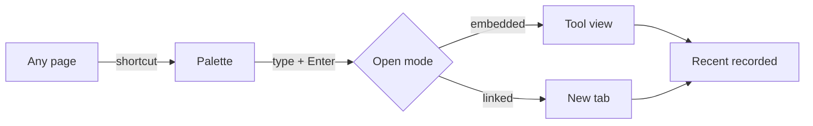

## Goal
The Owner opens a known tool in about a second without touching the mouse.

## Diagram

## Steps
1. On any page, for example SCR-Home, press the shortcut (F-004.R1).
2. Type part of the name. The best match is highlighted (F-004.R3).
3. Press Enter. The tool opens embedded in SCR-ToolView or in a new tab (F-003.R2, F-003.R4).
4. A recent visit is recorded (F-006.R1).

## Exits & failures
- Escape closes the palette without changes.
- Offline and not offline-capable: the offline state is shown (F-003.R6).
