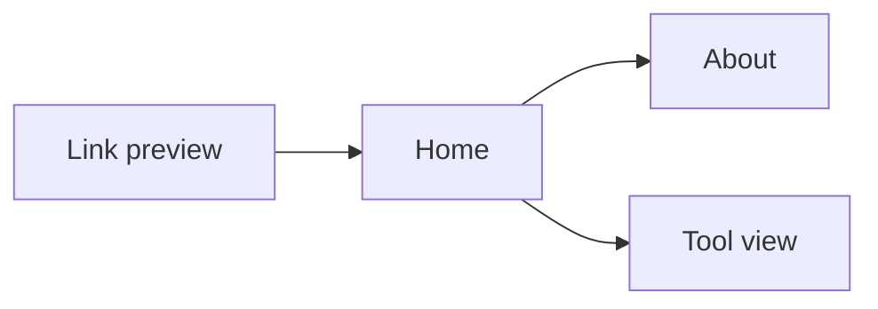

## Goal
A visitor arriving from a shared link understands who Taro is and tries a tool.

## Diagram

## Steps
1. The visitor sees a rich preview and follows the link (F-015.R1).
2. SCR-Home shows the greeting, introduction and the explore invitation (F-007.R5, F-007.R6).
3. The visitor opens SCR-About (F-008.R1).
4. The visitor tries a tool in SCR-ToolView (F-003.R1).

## Exits & failures
- A dead or old link: not-found with a way to the catalog (F-003.R7).
