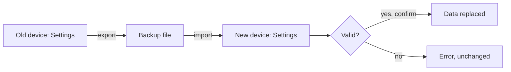

## Goal
The Owner carries favorites, recents, theme and days used to another device.

## Diagram

## Steps
1. On the old device, SCR-Settings → export (F-013.R1).
2. Move the file by any means the Owner chooses.
3. On the new device, SCR-Settings → import, then confirm (F-013.R2, F-013.R4).

## Exits & failures
- An invalid file leaves data unchanged (F-013.R2).
- Cancel leaves data unchanged (F-013.R4).
