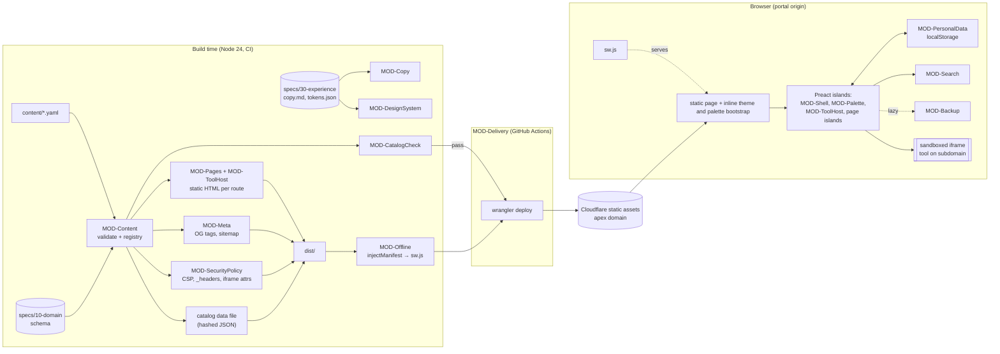

# Architecture overview

TaroKit is a **pre-rendered static site with a few islands of interactivity**, plus a service worker. There is no backend. All behavior that depends on the viewer runs in the browser:
- device data (favorites, recents, theme, days used);
- the current local date and time;
- connectivity.

All behavior that depends on the Owner's content is resolved at build from one validated registry.

Decisions: ADR-0001 (domain layout), ADR-0002 (Astro + Preact islands), ADR-0003 (CSS and tokens), ADR-0004 (service worker), ADR-0005 (content validation), ADR-0006 (testing), ADR-0007 (hosting and CI), ADR-0008 (licensing), ADR-0009 (isolation and headers), ADR-0010 (device storage). Dependencies: `dependencies.md`. Neutral-to-platform terms: `platform-mapping.md`. Unknowns: `spikes.md`.

## Module map

## Data flow

1. **Authoring.** The Owner edits `content/tools/<id>.yaml` (or a project, category, profile or Now file) and opens a pull request.
2. **Build.**
   - MOD-Content parses every file, validates it against the domain schema, then runs the cross-entry invariants. Any failure stops the build with `file › entry › rule` messages (F-001.R2).
   - The resulting **registry** feeds:
     - the static routes (MOD-Pages, MOD-ToolHost), with one `/t/<id>/` per visible tool;
     - head metadata and `sitemap.xml` (MOD-Meta);
     - CSP `frame-src`, the Permissions-Policy and `_headers` (MOD-SecurityPolicy);
     - the hashed catalog data file holding visible tools, projects, categories and pre-normalized search keys (MOD-Search keys).
   - After `astro build`, MOD-Offline injects the precache manifest into `sw.js`.
3. **Gate.**
   - On a pull request: lint, types, unit tests, Chromium e2e with axe, size pre-check and license audit.
   - On `main`: all of the above, plus three-engine e2e, Lighthouse budgets and **MOD-CatalogCheck**. Only if everything passes does `wrangler deploy` run.
   - Weekly: the catalog check alone, failing the run to notify the Owner.
4. **First visit.**
   - The host returns static HTML. The inline theme script sets the theme before paint, and the inline palette bootstrap arms Mod+K.
   - Islands hydrate and read personal data synchronously from localStorage, then render favorites, recents and what's new, computed against today's local date.
   - On idle, the catalog data file is prefetched for the palette, and the service worker installs and precaches the site.
5. **Repeat or installed visit.** The service worker serves every page and asset from the cache, so the shell is instant (NFR-01 repeat target). If a new deploy is detected, the shell shows the update message and waits for the user.
6. **Opening a tool.**
   - **Embedded:** navigate to `/t/<id>/`. MOD-ToolHost records the visit and creates the sandboxed iframe. The tool runs on its own subdomain origin with its own storage, which is shared with direct visits because the site is the same.
   - **Linked:** open a new tab with `noopener noreferrer` and record the visit.
7. **Backup.** Export serializes the personal-data document to a downloaded file. Import validates it in the browser with the standalone schema validator and the RULE-08 checks, then replaces the data after the user confirms. Nothing touches the network (INV-05).

## Runtime boundaries
- **Portal origin** (`https://<apex>`): the HTML, assets, `sw.js` and personal data. Nothing from other origins loads into it, except frames from the `frame-src` allowlist.
- **Tool origins** (`https://<tool>.<apex>`): independent deploys. They are reachable only as sandboxed frames or new tabs. They share the *site* with the portal, never the *origin*.
- **Islands** communicate only through signals in MOD-PersonalData, MOD-Theme and MOD-Offline, and through the `openPalette` DOM event. Islands never import each other.

## Performance baselines

These are targets that implementation must meet. Measurement rigs are in ADR-0006, and the environment is in `reference-environment.md`. Lighthouse is configured with custom throttling to match it: 4× CPU, 9000 Kbps down, 1500 Kbps up, 170 ms RTT.

| Item (home, compressed) | Budget | Basis |
|---|---|---|
| HTML (including inline scripts, inline SVG icons, CSP meta) | ≤ 20 KB | Content page, about 8 cards |
| CSS (tokens + base + components) | ≤ 15 KB | Scoped CSS, no framework |
| JS: island runtime + Preact + signals | ≤ 12 KB | measured in SP-5: 9.6 KB (preact about 4.5 KB, signals 3.7 KB, astro-island about 1 KB); 11.6 KB including inline scripts |
| JS: home islands (lists, clock) + shell islands | ≤ 15 KB | |
| JS: palette island (idle prefetch) | ≤ 12 KB | |
| Catalog data file | ≤ 10 KB for 50 entries; about 35 KB for 500 | About 300 B raw per entry |
| Fonts (at most 2 WOFF2 subsets, variable) | ≤ 80 KB | Latin + Vietnamese subsets |
| Manifest, favicon, workbox-window | ≤ 8 KB | |
| **Total initial transfer** | **≤ 170 KB** (30 KB headroom under NFR-11's 200 KB) | The avatar is excluded, per NFR-11 |

| Interaction | Target | Design lever |
|---|---|---|
| Home greeting and search usable, first visit | ≤ 1.5 s (NFR-01) | Static HTML; greeting set by an inline script; search control works through the bootstrap before hydration |
| Same, repeat or installed visit | ≤ 0.5 s (NFR-01) | Pages and assets served from the precache |
| Palette open after shortcut | ≤ 100 ms (NFR-02) | Pre-rendered `<dialog>` opened by the bootstrap; the island is already idle-loaded |
| Results per keystroke, 500 entries | ≤ 50 ms (NFR-02) | Pre-normalized keys, one linear pass (under 1 ms), at most 8 rows per group (at most 32 rows rendered) |
| Embedded tool slow hint | 10 s (RULE-11) | Timer in MOD-ToolHost |

## Key risks
1. **Same-site storage sharing in all engines, and iOS installed-app storage isolation.** Affects F-003.R8 and ADR-0001. Covered by SP-1.
2. **Unenforceable permissions on some engines.** clipboard-write is not policy-gated in Gecko and WebKit, and file-pick has no switch anywhere. Affects F-003.AC3 and RULE-10 wording. Covered by SP-3.
3. **Precache growth with catalog size.** Affects NFR-06. Covered by SP-4.
4. **Embeddability classification false positives or negatives,** including bot-protection 403 responses to CI. Affects F-014. Covered by SP-2.
5. **Scheduled CI silently disabled** after 60 days without activity (public repos). Affects F-014.R5. Mitigated by the release checklist.
6. **Ecosystem version skew.** `@vite-pwa/astro` doesn't support Astro 7, `@astrojs/preact` doesn't support Preact 11, and `@astrojs/check` doesn't support TS 7. Mitigated by pinning, documented in `dependencies.md`.
7. **Host-injected scripts or cookies** (analytics, bot protection) breaking NFR-05. Mitigated by zone hygiene and a production smoke test (ADR-0007).

## Proposed spec changes (need the user's approval)
- **RULE-10:** state that the base capability includes submitting forms within the tool's own frame (`allow-forms`), and that permissions are enforced "where the browser can restrict them" (file-pick everywhere, clipboard-write on Gecko and WebKit). SP-3 confirms the wording.
- **INV-03 or RULE-10:** add that an embedded tool's address must not share the portal's origin, as a build error (ADR-0009).
- **F-003.R8:** possibly scope out the installed app on iOS, where the installed app's storage differs from Safari tabs. SP-1 confirms.
